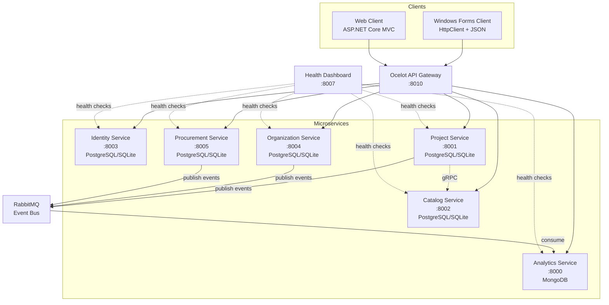

## Product Overview

Enterprise-grade information system for a landscape design studio, built as a microservices-based client-server architecture with a central API gateway. The system manages the full business lifecycle: sales and client relations, project design and execution, procurement and logistics, employee organization, and estimate calculations. It includes a Web client and a Windows Forms desktop client, both communicating with backend microservices via JSON HTTP contracts.

## Core Features

### Role Model & Security

- Two roles: **Administrator** (full CRUD on all entities, user management, analytics export) and **User** (limited CRUD based on permissions — e.g., can manage projects but not manage system users)
- Position (должность) and system role (роль) are separate entities — a foreman can be a regular User, and an Administrator is not necessarily the organization head
- JWT-based authentication with role/permission claims

### Employee & Organization Management

- Employees, positions, brigades (teams), worker-to-project assignment, responsible person assignment
- Separation of organizational position from system account role

### Sales & CRM

- Incoming leads, clients, negotiations, preliminary proposals, estimate approval, contracts, and work orders
- Full pipeline from initial interest to active work task

### Design & Work Execution

- Land plots (участки), landscaping projects, work stages, tasks, deadlines, assigned employees and brigades, materials used, execution results

### Procurement, Inventory & Logistics

- Suppliers, purchase orders, order line items, material receipts, stock balances and movements, delivery logistics (date, responsible person, cargo composition, delivery status)

### Estimates & Calculations

- Estimate line items (works, materials, quantity, measurement units, unit prices, work/material costs), project cost totals, actual vs. estimated variance tracking

### Data, Analytics & Export/Import

- Analytics with tabular result export to text files (pipe/CSV-delimited)
- Save application state at any time and load previously saved data
- Import from text file, export and re-import data
- State save/restore (JSON serialization)

### Exception Handling, OOP & Patterns

- Custom exception hierarchy + global exception handling middleware
- OOP: inheritance, polymorphism, encapsulation, abstraction throughout domain entities
- Design patterns: CQRS, Repository, Mediator, Factory, Strategy, Observer (event bus), Specification, Decorator

## Tech Stack

- **Framework**: .NET 8.0 (ASP.NET Core Web API for services, Windows Forms for desktop client, ASP.NET Core MVC for web client)
- **Microservices Communication**: Ocelot API Gateway, gRPC for inter-service calls, MassTransit + RabbitMQ for event-driven messaging
- **Relational DB**: PostgreSQL (primary) with SQLite fallback — configurable per service via connection string switching + EF Core provider selection
- **NoSQL DB**: MongoDB for services benefiting from document storage (analytics/event logs, audit trail)
- **ORM**: Entity Framework Core 8 (Npgsql for PostgreSQL, Microsoft.Data.Sqlite for SQLite fallback)
- **Architecture**: Clean Architecture (Domain → Application → Infrastructure → API), CQRS with MediatR
- **Validation**: FluentValidation with MediatR pipeline behaviour
- **Logging**: Serilog (Console + Elasticsearch), structured logging
- **Auth**: JWT Bearer tokens, role/permission-based authorization
- **Serialization**: System.Text.Json (JSON contracts, state save/restore), custom text-file serializers for tabular export/import
- **Patterns**: CQRS, Repository, Mediator, Factory (DbContext provider factory), Strategy (database provider selection, export format strategy), Observer (MassTransit event bus), Specification (query filtering), Decorator (caching/logging decorators)
- **Health Checks**: Existing HealthChecksUI dashboard (WebStatus) extended for all new services
- **Docker**: docker-compose with PostgreSQL, MongoDB, RabbitMQ, all microservices, gateway, and clients

## Implementation Approach

### Strategy

Transform the existing banking-template microservices into a landscape design studio system by repurposing the existing 3 services (Account → Project, Customer → Catalog, Transaction → Analytics/NoSQL) and adding 3 new services (Identity, Organization, Procurement). The existing Clean Architecture pattern (4-layer: Domain/Application/Infrastructure/API) with CQRS + MediatR + Repository + FluentValidation will be replicated for all new services. The existing building blocks (Common.Logging, EventBus.Messages) will be extended with new integration events.

### Database Provider Strategy (PostgreSQL + SQLite Fallback)

A **DatabaseProviderFactory** (Factory pattern + Strategy pattern) will select the EF Core provider at startup based on configuration. If PostgreSQL/MSSQL is unreachable, the system automatically falls back to a local SQLite file. Each service's `InfrastructureServiceRegistration` will call this factory to configure `DbContextOptions` with the appropriate provider. This satisfies the "fallback to local sqlite always possible" requirement.

```
public interface IDatabaseProviderStrategy
{
    DbContextOptionsBuilder<TContext> Configure<TContext>(DbContextOptionsBuilder<TContext> builder, string connectionStringName) where TContext : DbContext;
}

public class PostgresStrategy : IDatabaseProviderStrategy { ... }   // Npgsql provider
public class SqliteStrategy : IDatabaseProviderStrategy { ... }     // SQLite fallback
public class SqlServerStrategy : IDatabaseProviderStrategy { ... }  // MSSQL option
```

### Service Mapping (Existing → New Domain)

| Existing Project | New Domain | Database | Changes |
| --- | --- | --- | --- |
| Account.* (4 layers) | **Project Service** (участки, проекты, этапы, задачи, сметы) | PostgreSQL + SQLite fallback | Full rewrite of domain entities, commands, queries, controller endpoints |
| Customer.* (4 layers + GRPC) | **Catalog Service** (растения, материалы, виды работ, единицы измерения, цены) | PostgreSQL + SQLite fallback | Full rewrite of domain entities, commands, queries; keep gRPC for inter-service checks |
| Transaction.API | **Analytics Service** (аналитика, экспорт, аудит-лог событий) | MongoDB | Repurpose transaction store into analytics/event store with aggregation queries |
| NEW: Identity.* (4 layers) | **Identity Service** (пользователи, роли, JWT auth) | PostgreSQL + SQLite fallback | New service following same Clean Architecture pattern |
| NEW: Organization.* (4 layers) | **Organization Service** (сотрудники, должности, бригады, назначения) | PostgreSQL + SQLite fallback | New service |
| NEW: Procurement.* (4 layers) | **Procurement Service** (поставщики, закупки, запасы, логистика) | PostgreSQL + SQLite fallback | New service |


### Architecture Diagram



### Data Flow

1. User logs in via Identity Service → receives JWT with role/permission claims
2. Client includes JWT in all subsequent requests through Gateway
3. Gateway routes to appropriate microservice
4. Each service validates permissions via `[Authorize(Roles=...)]` and custom permission attributes
5. Cross-service calls via gRPC (e.g., Project Service checks Catalog items via Customer.GRPC pattern)
6. Domain events published to RabbitMQ → Analytics Service consumes and stores in MongoDB
7. Analytics Service provides aggregation queries + text-file export endpoints

## Implementation Notes

### Reuse Existing Patterns

- Replicate the existing `EntityBase` abstract class (Id, CreatedDate, LastModifiedDate) in all new domain layers
- Replicate the existing `RepositoryBase<T>` generic repository — but fix the hardcoded context type by using `DbContext` generically
- Replicate `ApplicationServiceRegistration` (AutoMapper + FluentValidation + MediatR + pipeline behaviours) for all new services
- Replicate `InfrastructureServiceRegistration` pattern, adding the database provider factory
- Replicate `HostExtensions.MigrateDatabase<TContext>()` with Polly retry — extend to handle both Npgsql and Sqlite exceptions
- Replicate the existing gRPC inter-service pattern (proto + service + client wrapper)
- Replicate the existing MassTransit publisher/consumer pattern for new integration events

### Fix Known Bugs During Transformation

- Remove dead `NotImplementedException` overloads in Account handlers/behaviours (these will be rewritten anyway)
- Fix `AccountQueryHandler` logic bug (will be replaced with Project queries)
- Add null checks in all query handlers
- Remove unnecessary `Microsoft.Data.SqlClient` from Customer.API.csproj
- Remove `Transaction.GRPC` placeholder scaffold entirely
- Make `RepositoryBase<T>` use `DbContext` base type, not concrete context

### Performance Considerations

- Use `AsNoTracking()` on all read queries (existing pattern in RepositoryBase)
- MediatR pipeline: validation behaviour runs before handler — no extra DB round-trips
- MongoDB aggregation pipelines for analytics (not client-side aggregation)
- Ocelot caching already configured — extend routes for new services
- Pagination on all list endpoints to avoid loading large datasets
- EF Core compiled queries for hot paths if needed

### Logging

- Reuse `Common.Logging.SeriLogger.Configure` for all new services
- Log all MediatR exceptions via existing `UnhandledExceptionBehaviour`
- No PII in logs — JWT tokens and passwords never logged
- Rate-limit Elasticsearch writes via batch configuration

### Blast Radius Control

- Existing docker-compose extended, not replaced — old service names preserved for backward compat
- Connection strings in appsettings.json with SQLite fallback path always configured
- All new services have independent health check endpoints
- Gateway routes added incrementally — existing routes preserved during transition

## Architecture Design

### Clean Architecture Per Service (4 Layers)

Each microservice follows the existing pattern:

```
ServiceName/
├── ServiceName.Domain/           # Entities, value objects, domain events, interfaces
│   ├── Common/EntityBase.cs
│   ├── Entities/                 # Domain entity classes
│   └── Enums/                    # Domain enums
├── ServiceName.Application/      # CQRS commands/queries, DTOs, mappings, validators, behaviours, exceptions
│   ├── Behaviours/               # UnhandledExceptionBehaviour, ValidationBehaviour
│   ├── Commands/                 # Command + Handler + Validator per feature
│   ├── Queries/                  # Query + Handler + Validator per feature
│   ├── Contracts/Persistence/    # IRepositoryBase<T>, IServiceRepository
│   ├── Exceptions/               # Custom exceptions
│   ├── Mappings/                 # AutoMapper profiles
│   └── ApplicationServiceRegistration.cs
├── ServiceName.Infrastructure/   # EF Core DbContext, repositories, migrations, seeding, DB provider factory
│   ├── Persistence/              # Context, Seed
│   ├── Repositories/             # RepositoryBase<T>, concrete repositories
│   ├── Migrations/
│   └── InfrastructureServiceRegistration.cs
└── ServiceName.API/              # Controllers, Program.cs, middleware, gRPC services, Dockerfile
    ├── Controllers/
    ├── Extensions/
    └── Program.cs
```

### Shared Building Blocks (Extended)

- `Common.Logging` — unchanged, reused by all services
- `EventBus.Messages` — extended with new integration events: `ProjectCreatedEvent`, `EmployeeAssignedEvent`, `PurchaseOrderCreatedEvent`, `EstimateApprovedEvent`, etc.
- NEW: `BuildingBlocks/Shared.Common/` — shared base classes extracted from duplicated code:
- `EntityBase` (currently duplicated in Account.Domain and Customer.Domain)
- `IDatabaseProviderStrategy` + implementations
- `IRepositoryBase<T>` (currently duplicated)
- `RepositoryBase<T>` (currently duplicated, with fix)
- Custom exception types
- Export/import serialization utilities
- Specification pattern base classes

## Directory Structure

### Summary

The implementation transforms 3 existing services and adds 3 new services, 2 new clients, 1 new shared building block, a specification document, and updates to docker-compose and gateway configuration. All existing patterns (Clean Architecture, CQRS, Repository, MediatR pipeline) are replicated.

```
src/
├── docs/
│   └── PLANNING_SPECIFICATION.md                    # [NEW] Full planning & specification document with architecture, domain model, API contracts, role matrix, data flow
├── BuildingBlocks/
│   ├── Common.Logging/                               # [KEEP] Unchanged — Serilog configuration
│   ├── EventBus.Messages/                            # [MODIFY] Add new integration events for landscape studio domain
│   │   ├── Common/EventBusConstants.cs              # [MODIFY] Add new queue names
│   │   ├── Events/IntegrationBaseEvent.cs           # [KEEP]
│   │   ├── Events/ProjectStageCompletedEvent.cs     # [NEW] Published when a project stage completes
│   │   ├── Events/EmployeeAssignedEvent.cs          # [NEW] Published when employee assigned to project
│   │   ├── Events/PurchaseOrderCreatedEvent.cs      # [NEW] Published when purchase order created
│   │   ├── Events/EstimateApprovedEvent.cs          # [NEW] Published when estimate approved
│   │   ├── Events/MaterialReceivedEvent.cs          # [NEW] Published when materials received in stock
│   │   └── Enums/ProjectStatus.cs                   # [NEW] Shared status enum
│   └── Shared.Common/                                # [NEW] Shared building block for de-duplicated base classes
│       ├── Shared.Common.csproj
│       ├── Common/EntityBase.cs                     # [NEW] Extracted from Account/Customer Domain — abstract base entity
│       ├── Common/IDatabaseProviderStrategy.cs      # [NEW] Strategy interface for DB provider selection
│       ├── Common/PostgresProviderStrategy.cs       # [NEW] PostgreSQL EF Core configuration
│       ├── Common/SqliteProviderStrategy.cs         # [NEW] SQLite fallback configuration
│       ├── Common/SqlServerProviderStrategy.cs      # [NEW] MSSQL configuration option
│       ├── Common/DatabaseProviderFactory.cs        # [NEW] Factory that selects strategy based on config
│       ├── Persistence/IRepositoryBase.cs           # [NEW] Generic repository interface (de-duplicated)
│       ├── Persistence/RepositoryBase.cs            # [NEW] Generic repository impl with DbContext base (fixed)
│       ├── Exceptions/NotFoundException.cs          # [NEW] De-duplicated custom exception
│       ├── Exceptions/ValidationException.cs        # [NEW] De-duplicated custom exception
│       ├── Exceptions/ForbiddenException.cs         # [NEW] Permission denied exception
│       ├── Serialization/ITextFileSerializer.cs     # [NEW] Strategy interface for text export/import
│       ├── Serialization/PipeDelimitedSerializer.cs # [NEW] Pipe-delimited text format serializer
│       ├── Serialization/CsvTextSerializer.cs       # [NEW] CSV text format serializer
│       ├── Serialization/JsonStateSerializer.cs     # [NEW] JSON state save/restore utility
│       ├── Specifications/ISpecification.cs         # [NEW] Specification pattern interface
│       └── Specifications/BaseSpecification.cs      # [NEW] Base specification implementation
├── ApiGateways/
│   └── OcelotApiGateway/                            # [MODIFY] Update ocelot.json with routes for all 6 services + auth
│       ├── Program.cs                               # [MODIFY] Add JWT authentication to gateway
│       ├── ocelot.json                              # [MODIFY] Add routes for all new services, remove old banking routes
│       └── ocelot.Development.json                  # [MODIFY] Same
├── Services/
│   ├── Identity/                                     # [NEW] Auth, users, roles, permissions — 4-layer Clean Architecture
│   │   ├── Identity.Domain/
│   │   │   ├── Entities/User.cs                     # [NEW] User entity (username, passwordHash, role, isActive)
│   │   │   ├── Entities/Role.cs                     # [NEW] Role entity (Administrator, User)
│   │   │   ├── Entities/Permission.cs               # [NEW] Permission entity
│   │   │   ├── Entities/RolePermission.cs           # [NEW] Many-to-many role-permission
│   │   │   └── Enums/UserRole.cs                    # [NEW] UserRole enum (Administrator=0, User=1)
│   │   ├── Identity.Application/
│   │   │   ├── Commands/Auth/LoginCommand.cs       # [NEW] Login command + handler (JWT generation)
│   │   │   ├── Commands/Auth/LoginValidator.cs     # [NEW]
│   │   │   ├── Commands/Users/CreateUserCommand.cs # [NEW] Admin-only user creation
│   │   │   ├── Commands/Users/UpdateUserCommand.cs # [NEW]
│   │   │   ├── Commands/Users/DeleteUserCommand.cs # [NEW]
│   │   │   ├── Queries/GetUserByIdQuery.cs         # [NEW]
│   │   │   ├── Queries/GetAllUsersQuery.cs         # [NEW]
│   │   │   ├── DTOs/AuthResponse.cs                # [NEW] JWT token + user info response
│   │   │   ├── DTOs/UserDto.cs                     # [NEW]
│   │   │   ├── Contracts/IUserRepository.cs        # [NEW]
│   │   │   ├── Mappings/MappingProfile.cs          # [NEW]
│   │   │   └── ApplicationServiceRegistration.cs   # [NEW]
│   │   ├── Identity.Infrastructure/
│   │   │   ├── Persistence/IdentityContext.cs      # [NEW] DbContext with User, Role, Permission, RolePermission DbSets
│   │   │   ├── Persistence/IdentityContextSeed.cs  # [NEW] Seed admin user + roles + permissions
│   │   │   ├── Repositories/UserRepository.cs      # [NEW]
│   │   │   ├── Migrations/                         # [NEW] EF Core migrations
│   │   │   └── InfrastructureServiceRegistration.cs # [NEW] Register with DB provider factory
│   │   └── Identity.API/
│   │       ├── Controllers/AuthController.cs       # [NEW] POST /api/v1/Auth/login
│   │       ├── Controllers/UsersController.cs      # [NEW] CRUD users (Admin only)
│   │       ├── Middleware/                         # [NEW]
│   │       ├── Program.cs                          # [NEW] JWT config, Swagger with auth, health checks
│   │       └── Dockerfile                          # [NEW]
│   ├── Project/                                     # [MODIFY/REWRITE] Former Account service → Project service
│   │   ├── Project.Domain/
│   │   │   ├── Entities/LandPlot.cs                # [NEW] Участок (address, area, client ref)
│   │   │   ├── Entities/Project.cs                 # [NEW] Проект благоустройства (name, plot, status, dates)
│   │   │   ├── Entities/ProjectStage.cs            # [NEW] Этап работ (name, dates, status)
│   │   │   ├── Entities/ProjectTask.cs             # [NEW] Задача (stage, assignee, deadline, result)
│   │   │   ├── Entities/Estimate.cs                # [NEW] Смета (project, totalCost, status)
│   │   │   ├── Entities/EstimateLineItem.cs        # [NEW] Позиция сметы (type, ref, qty, unit, price, cost)
│   │   │   ├── Enums/ProjectStatus.cs              # [NEW] Planning, InProgress, Completed, OnHold
│   │   │   ├── Enums/EstimateLineItemType.cs      # [NEW] Work, Material
│   │   │   └── Common/EntityBase.cs                # [REPLACE] Reference Shared.Common.EntityBase
│   │   ├── Project.Application/
│   │   │   ├── Commands/LandPlots/                 # [NEW] Create/Update/Delete land plot commands + handlers + validators
│   │   │   ├── Commands/Projects/                  # [NEW] Create/Update/Delete project commands
│   │   │   ├── Commands/ProjectStages/             # [NEW] Create/Update stage commands
│   │   │   ├── Commands/ProjectTasks/              # [NEW] Create/Update/Assign task commands
│   │   │   ├── Commands/Estimates/                 # [NEW] Create estimate, add line item, approve estimate commands
│   │   │   ├── Queries/                            # [NEW] Get project by ID, list projects, get estimate, get tasks
│   │   │   ├── DTOs/                               # [NEW] All response/request DTOs
│   │   │   ├── Contracts/ILandPlotRepository.cs    # [NEW]
│   │   │   ├── Contracts/IProjectRepository.cs     # [NEW]
│   │   │   ├── Contracts/IProjectStageRepository.cs # [NEW]
│   │   │   ├── Contracts/IProjectTaskRepository.cs # [NEW]
│   │   │   ├── Contracts/IEstimateRepository.cs    # [NEW]
│   │   │   ├── Exceptions/                         # [NEW] Project-specific exceptions
│   │   │   ├── Mappings/MappingProfile.cs          # [NEW]
│   │   │   └── ApplicationServiceRegistration.cs   # [MODIFY]
│   │   ├── Project.Infrastructure/
│   │   │   ├── Persistence/ProjectContext.cs       # [NEW] DbContext replacing AccountContext
│   │   │   ├── Persistence/ProjectContextSeed.cs   # [NEW] Seed sample projects/plots/estimates
│   │   │   ├── Repositories/                       # [NEW] All repository implementations
│   │   │   ├── Migrations/                         # [NEW] EF Core migrations for all entities
│   │   │   └── InfrastructureServiceRegistration.cs # [MODIFY] Use DB provider factory
│   │   └── Project.API/
│   │       ├── Controllers/LandPlotsController.cs  # [NEW] CRUD endpoints
│   │       ├── Controllers/ProjectsController.cs   # [NEW] CRUD + stage/task management
│   │       ├── Controllers/EstimatesController.cs  # [NEW] CRUD + approve + variance calc
│   │       ├── Controllers/ProjectStagesController.cs # [NEW]
│   │       ├── Controllers/ProjectTasksController.cs  # [NEW]
│   │       ├── Program.cs                          # [REWRITE] Project service startup
│   │       └── Dockerfile                          # [KEEP/MODIFY]
│   ├── Catalog/                                     # [MODIFY/REWRITE] Former Customer service → Catalog service
│   │   ├── Catalog.Domain/
│   │   │   ├── Entities/Plant.cs                   # [NEW] Растение (name, latin name, category, care level)
│   │   │   ├── Entities/Material.cs                # [NEW] Материал (name, unit, unit price, stock qty)
│   │   │   ├── Entities/WorkType.cs               # [NEW] Вид работ (name, unit, unit price)
│   │   │   ├── Entities/MeasurementUnit.cs         # [NEW] Единица измерения (name, symbol)
│   │   │   └── Common/EntityBase.cs                # [REPLACE]
│   │   ├── Catalog.Application/
│   │   │   ├── Commands/Plants/                    # [NEW] CRUD plant commands
│   │   │   ├── Commands/Materials/                 # [NEW] CRUD material commands
│   │   │   ├── Commands/WorkTypes/                 # [NEW] CRUD work type commands
│   │   │   ├── Commands/MeasurementUnits/          # [NEW] CRUD unit commands
│   │   │   ├── Queries/                            # [NEW] Get/list queries for all entities
│   │   │   ├── DTOs/                               # [NEW]
│   │   │   ├── Contracts/                          # [NEW] Repository interfaces
│   │   │   ├── Mappings/MappingProfile.cs          # [NEW]
│   │   │   └── ApplicationServiceRegistration.cs   # [MODIFY]
│   │   ├── Catalog.Infrastructure/
│   │   │   ├── Persistence/CatalogContext.cs       # [NEW] Replacing CustomerContext
│   │   │   ├── Persistence/CatalogContextSeed.cs   # [NEW] Seed sample plants/materials/work types
│   │   │   ├── Repositories/                       # [NEW]
│   │   │   ├── Migrations/                         # [NEW]
│   │   │   └── InfrastructureServiceRegistration.cs # [MODIFY]
│   │   ├── Catalog.API/                             # [REWRITE] Former Customer.API
│   │   │   ├── Controllers/PlantsController.cs     # [NEW]
│   │   │   ├── Controllers/MaterialsController.cs  # [NEW]
│   │   │   ├── Controllers/WorkTypesController.cs  # [NEW]
│   │   │   ├── Controllers/MeasurementUnitsController.cs # [NEW]
│   │   │   ├── Program.cs                          # [REWRITE]
│   │   │   └── Dockerfile                          # [KEEP/MODIFY]
│   │   └── Catalog.GRPC/                            # [MODIFY] Former Customer.GRPC
│   │       ├── Services/CatalogService.cs          # [NEW] gRPC for checking plant/material existence
│   │       ├── Protos/catalog.proto                # [NEW] Proto definition for catalog checks
│   │       └── Program.cs                          # [REWRITE]
│   ├── Organization/                               # [NEW] Employee & org management — 4-layer
│   │   ├── Organization.Domain/
│   │   │   ├── Entities/Employee.cs               # [NEW] Сотрудник (name, position ref, user account ref)
│   │   │   ├── Entities/Position.cs               # [NEW] Должность (title, description)
│   │   │   ├── Entities/Brigade.cs                # [NEW] Бригада (name, leader ref)
│   │   │   ├── Entities/BrigadeMember.cs           # [NEW] Many-to-many brigade-employee
│   │   │   ├── Entities/ProjectAssignment.cs       # [NEW] Employee/brigade assigned to project
│   │   │   └── Common/EntityBase.cs               # [REPLACE] Reference Shared.Common
│   │   ├── Organization.Application/
│   │   │   ├── Commands/Employees/                 # [NEW] CRUD employee commands
│   │   │   ├── Commands/Positions/                 # [NEW] CRUD position commands
│   │   │   ├── Commands/Brigades/                  # [NEW] CRUD brigade + assign member commands
│   │   │   ├── Commands/Assignments/               # [NEW] Assign to project, set responsible
│   │   │   ├── Queries/                            # [NEW] Get/list queries
│   │   │   ├── DTOs/                               # [NEW]
│   │   │   ├── Contracts/                          # [NEW] Repository interfaces
│   │   │   ├── Mappings/MappingProfile.cs          # [NEW]
│   │   │   └── ApplicationServiceRegistration.cs   # [NEW]
│   │   ├── Organization.Infrastructure/
│   │   │   ├── Persistence/OrganizationContext.cs  # [NEW]
│   │   │   ├── Persistence/OrganizationContextSeed.cs # [NEW]
│   │   │   ├── Repositories/                       # [NEW]
│   │   │   ├── Migrations/                         # [NEW]
│   │   │   └── InfrastructureServiceRegistration.cs # [NEW]
│   │   └── Organization.API/
│   │       ├── Controllers/EmployeesController.cs  # [NEW]
│   │       ├── Controllers/PositionsController.cs  # [NEW]
│   │       ├── Controllers/BrigadesController.cs   # [NEW]
│   │       ├── Controllers/AssignmentsController.cs # [NEW]
│   │       ├── Program.cs                          # [NEW]
│   │       └── Dockerfile                          # [NEW]
│   ├── Procurement/                                 # [NEW] Procurement, inventory, logistics — 4-layer
│   │   ├── Procurement.Domain/
│   │   │   ├── Entities/Supplier.cs               # [NEW] Поставщик (name, contact, address)
│   │   │   ├── Entities/PurchaseOrder.cs           # [NEW] Заказ на закупку (supplier, date, status)
│   │   │   ├── Entities/PurchaseOrderItem.cs       # [NEW] Позиция заказа (material ref, qty, unit price)
│   │   │   ├── Entities/MaterialReceipt.cs         # [NEW] Поступление материалов
│   │   │   ├── Entities/StockBalance.cs            # [NEW] Остаток запаса (material, location, qty)
│   │   │   ├── Entities/StockMovement.cs           # [NEW] Движение запаса (in/out, qty, date, reason)
│   │   │   ├── Entities/Delivery.cs               # [NEW] Доставка (date, responsible, cargo, status)
│   │   │   ├── Entities/DeliveryItem.cs            # [NEW] Состав груза
│   │   │   └── Enums/                              # [NEW] PurchaseStatus, DeliveryStatus, MovementType
│   │   ├── Procurement.Application/
│   │   │   ├── Commands/Suppliers/                 # [NEW] CRUD supplier
│   │   │   ├── Commands/PurchaseOrders/            # [NEW] Create order, add items, receive
│   │   │   ├── Commands/Deliveries/                # [NEW] Schedule, update status
│   │   │   ├── Commands/Stock/                     # [NEW] Adjust stock, record movement
│   │   │   ├── Queries/                            # [NEW] Get stock balances, movements, orders
│   │   │   ├── DTOs/                               # [NEW]
│   │   │   ├── Contracts/                          # [NEW]
│   │   │   ├── Mappings/MappingProfile.cs          # [NEW]
│   │   │   └── ApplicationServiceRegistration.cs   # [NEW]
│   │   ├── Procurement.Infrastructure/
│   │   │   ├── Persistence/ProcurementContext.cs   # [NEW]
│   │   │   ├── Persistence/ProcurementContextSeed.cs # [NEW]
│   │   │   ├── Repositories/                       # [NEW]
│   │   │   ├── Migrations/                         # [NEW]
│   │   │   └── InfrastructureServiceRegistration.cs # [NEW]
│   │   └── Procurement.API/
│   │       ├── Controllers/SuppliersController.cs  # [NEW]
│   │       ├── Controllers/PurchaseOrdersController.cs # [NEW]
│   │       ├── Controllers/DeliveriesController.cs # [NEW]
│   │       ├── Controllers/StockController.cs      # [NEW]
│   │       ├── Program.cs                          # [NEW]
│   │       └── Dockerfile                          # [NEW]
│   ├── Analytics/                                   # [MODIFY/REWRITE] Former Transaction service → Analytics service
│   │   └── Analytics.API/
│   │       ├── Entities/AnalyticsEvent.cs          # [NEW] MongoDB document for domain events (replaces Transaction)
│   │       ├── Entities/AuditLog.cs               # [NEW] MongoDB document for audit trail
│   │       ├── Data/AnalyticsContext.cs            # [NEW] MongoDB context (replaces TransactionContext)
│   │       ├── Data/AnalyticsContextSeed.cs        # [NEW]
│   │       ├── Repositories/AnalyticsRepository.cs # [NEW] MongoDB aggregation queries
│   │       ├── Repositories/AuditLogRepository.cs  # [NEW]
│   │       ├── Services/AnalyticsService.cs        # [NEW] Aggregation logic + export
│   │       ├── Services/ExportService.cs           # [NEW] Text-file export using ITextFileSerializer strategy
│   │       ├── Services/ImportService.cs           # [NEW] Text-file import using ITextFileSerializer strategy
│   │       ├── Services/StateService.cs            # [NEW] Save/load application state (JSON serialization)
│   │       ├── EventBusConsumer/                   # [NEW] Consumers for all new integration events
│   │       ├── Controllers/AnalyticsController.cs  # [NEW] GET analytics with filters, GET export
│   │       ├── Controllers/ExportImportController.cs # [NEW] POST export, POST import, GET/POST state save/load
│   │       ├── Mappings/MappingProfile.cs          # [NEW]
│   │       ├── Program.cs                          # [REWRITE]
│   │       └── Dockerfile                          # [KEEP/MODIFY]
│   └── Transaction/                                 # [DELETE] Transaction.GRPC placeholder removed
├── WebApps/
│   ├── WebStatus/                                   # [MODIFY] Add health check endpoints for new services
│   │   └── Program.cs                              # [MODIFY] Add health check URIs for Identity, Organization, Procurement
│   └── LandscapeStudio.Web/                        # [NEW] ASP.NET Core MVC web client
│       ├── LandscapeStudio.Web.csproj              # [NEW]
│       ├── Program.cs                              # [NEW] MVC + HttpClient + JWT auth cookie
│       ├── Controllers/
│       │   ├── AuthController.cs                   # [NEW] Login/logout, JWT storage
│       │   ├── ProjectsController.cs              # [NEW] View/list/create projects
│       │   ├── CatalogController.cs               # [NEW] View plants/materials
│       │   ├── OrganizationController.cs          # [NEW] View employees/brigades
│       │   ├── ProcurementController.cs           # [NEW] View suppliers/orders
│       │   └── AnalyticsController.cs             # [NEW] View analytics, export
│       ├── Views/                                  # [NEW] Razor views for all controllers
│       ├── Models/                                 # [NEW] View models
│       ├── Services/ApiClientService.cs            # [NEW] Centralized HttpClient wrapper with JWT
│       └── wwwroot/                               # [NEW] Static assets, CSS
├── WinForms/
│   └── LandscapeStudio.WinForms/                   # [NEW] Windows Forms desktop client
│       ├── LandscapeStudio.WinForms.csproj         # [NEW] net8.0-windows, WinForms SDK
│       ├── Program.cs                              # [NEW] WinForms entry point
│       ├── Forms/
│       │   ├── LoginForm.cs                        # [NEW] Login form with validation
│       │   ├── MainForm.cs                         # [NEW] Main MDI/tabbed container
│       │   ├── ProjectsForm.cs                     # [NEW] Projects DataGridView + CRUD
│       │   ├── ProjectDetailForm.cs               # [NEW] Stages/tasks/estimates management
│       │   ├── CatalogForm.cs                     # [NEW] Plants/materials/work types DataGridView
│       │   ├── EmployeesForm.cs                   # [NEW] Employees/brigades management
│       │   ├── ProcurementForm.cs                 # [NEW] Suppliers/orders/deliveries
│       │   ├── StockForm.cs                       # [NEW] Stock balances/movements
│       │   ├── AnalyticsForm.cs                   # [NEW] Analytics view + export button
│       │   └── ExportImportForm.cs                # [NEW] Export/import/state save/load
│       ├── Services/ApiClientService.cs            # [NEW] HttpClient wrapper with JWT, centralized error handling
│       ├── Services/StateService.cs               # [NEW] Local state save/restore for WinForms
│       ├── Models/                                 # [NEW] DTOs for API communication
│       ├── Validators/                             # [NEW] Input validation logic
│       └── Dockerfile                              # [NEW] (optional, for containerized WinForms)
├── docker-compose.yml                               # [MODIFY] Add new databases, services, clients
├── docker-compose.override.yml                      # [MODIFY] Add ports/env for all new services
└── SOLUTION.BRU.TPPO.sln                           # [MODIFY] Add all new projects
```

## Key Code Structures

### Database Provider Strategy (Factory + Strategy Pattern)

```
// Shared.Common/Common/IDatabaseProviderStrategy.cs
public interface IDatabaseProviderStrategy
{
    string ProviderName { get; }
    DbContextOptionsBuilder<T> Configure<T>(DbContextOptionsBuilder<T> builder, string connectionString) where T : DbContext;
    bool CanConnect(string connectionString);
}

// Shared.Common/Common/DatabaseProviderFactory.cs
public class DatabaseProviderFactory
{
    private readonly IEnumerable<IDatabaseProviderStrategy> _strategies;
    private readonly ILogger<DatabaseProviderFactory> _logger;

    public DatabaseProviderFactory(IEnumerable<IDatabaseProviderStrategy> strategies, ILogger<DatabaseProviderFactory> logger);

    // Tries PostgreSQL/SqlServer first, falls back to SQLite if unreachable
    IDatabaseProviderStrategy Resolve(string preferredProvider, string connectionString);
}
```

### Text File Serializer (Strategy Pattern for Export/Import)

```
// Shared.Common/Serialization/ITextFileSerializer.cs
public interface ITextFileSerializer
{
    string Format { get; }
    string Serialize<T>(IEnumerable<T> data, string[]? headers = null);
    IEnumerable<T> Deserialize<T>(string content) where T : new();
}
```

### Specification Pattern (for Query Filtering)

```
// Shared.Common/Specifications/ISpecification.cs
public interface ISpecification<T>
{
    Expression<Func<T, bool>> ToExpression();
    bool IsSatisfiedBy(T entity);
}
```

## Design Approach

The Web client (ASP.NET Core MVC) will use a modern, professional enterprise dashboard design with a landscape/nature-inspired color palette. The Windows Forms client uses standard Windows-native controls (DataGridView, TabControl, MenuStrip) with a clean, functional enterprise layout optimized for data entry and table viewing.

### Web Client Design

- **Layout**: Top navigation bar with logo, user menu, and role-based menu items. Left sidebar with quick navigation. Main content area with data tables, cards, and forms.
- **Color Palette**: Deep forest green primary, earthy browns and sage greens for accents, warm cream backgrounds. Professional and nature-themed.
- **Typography**: Clean sans-serif (Source Sans Pro) for body, slightly larger headings.
- **Components**: Data tables with sorting/pagination, modal dialogs for create/edit, status badges, progress bars for project stages, breadcrumb navigation.
- **Responsive**: Desktop-first design with responsive grid layout.

### Windows Forms Client Design

- **Layout**: Login screen → Main form with MenuStrip (top) + TabControl (main area) + StatusStrip (bottom). Each tab hosts a DataGridView with toolbar buttons (Add, Edit, Delete, Refresh, Export).
- **Styling**: Standard Windows controls with consistent fonts, alternating row colors in grids, color-coded status cells.
- **Forms**: Modal dialog forms for create/edit operations with input validation and error providers.

## Agent Extensions

### SubAgent

- **code-explorer**
- Purpose: Explore existing codebase patterns during implementation to ensure new code matches existing conventions (Clean Architecture layering, MediatR CQRS structure, Repository pattern, gRPC proto definitions, docker-compose structure)
- Expected outcome: Verify file paths, existing class signatures, and pattern consistency before writing new service code