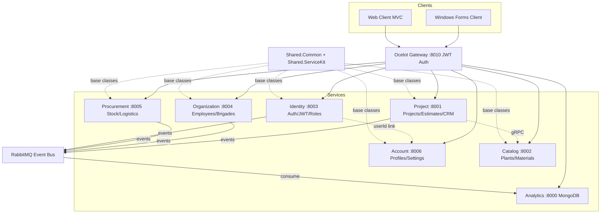

## plan for landscaping studio information system

Enterprise-grade information system for a landscape design studio, built as a microservices-based client-server architecture with a central API gateway. The system manages the full business lifecycle: sales and client relations, project design and execution, procurement and logistics, employee organization, and estimate calculations. It includes a Web client and a Windows Forms desktop client, both communicating with backend microservices via JSON HTTP contracts. An extensibility framework (Shared.Common + Shared.ServiceKit) enables adding new microservices easily by inheriting from base classes. Account and Identity are separate services: Identity handles auth/JWT/roles, Account handles profile/account data/preferences.

## Core Features

### Role Model & Security

- Two roles: **Administrator** (full CRUD on all entities, user management, analytics export) and **User** (limited CRUD based on permissions)
- Position (должность) and system role (роль) are separate entities
- JWT-based authentication with role/permission claims
- **Identity Service**: authentication, JWT generation, role/permission management, login/logout
- **Account Service** (separate): user profile data, account details, contact info, preferences, account settings

### Employee & Organization Management

- Employees, positions, brigades, worker-to-project assignment, responsible person assignment
- Separation of organizational position from system account role

### Sales & CRM

- Incoming leads, clients, negotiations, preliminary proposals, estimate approval, contracts, work orders
- Full pipeline from initial interest to active work task

### Design & Work Execution

- Land plots, landscaping projects, work stages, tasks, deadlines, assigned employees/brigades, materials, execution results

### Procurement, Inventory & Logistics

- Suppliers, purchase orders, order line items, material receipts, stock balances/movements, delivery logistics (date, responsible, cargo, status)

### Estimates & Calculations

- Estimate line items (works, materials, quantity, units, prices, costs), project cost totals, actual vs. estimated variance tracking

### Data, Analytics & Export/Import

- Analytics with tabular result export to text files (pipe/CSV-delimited)
- Save application state at any time and load previously saved data
- Import from text file, export and re-import data
- State save/restore (JSON serialization)

### Exception Handling, OOP & Patterns

- Custom exception hierarchy + global exception handling middleware
- OOP: inheritance, polymorphism, encapsulation, abstraction throughout domain entities
- Design patterns: CQRS, Repository, Mediator, Factory, Strategy, Observer, Specification, Decorator

### Extensibility Framework

- **Shared.Common**: de-duplicated base classes (EntityBase, IRepositoryBase, RepositoryBase, IDatabaseProviderStrategy, ITextFileSerializer, ISpecification, custom exceptions)
- **Shared.ServiceKit**: MicroserviceBootstrapBase, ServiceRegistrationBase, IServiceDefinition — new microservices can be created by inheriting from these base classes

## Tech Stack

- **Framework**: .NET 8.0 (ASP.NET Core Web API for services, Windows Forms for desktop client, ASP.NET Core MVC for web client)
- **Microservices Communication**: Ocelot API Gateway, gRPC for inter-service calls, MassTransit + RabbitMQ for event-driven messaging
- **Relational DB**: PostgreSQL (primary) with SQLite fallback — configurable per service via EF Core provider selection
- **NoSQL DB**: MongoDB for analytics/event logs/audit trail
- **ORM**: Entity Framework Core 8 (Npgsql, Microsoft.Data.Sqlite, Microsoft.EntityFrameworkCore.SqlServer)
- **Architecture**: Clean Architecture (Domain → Application → Infrastructure → API), CQRS with MediatR
- **Validation**: FluentValidation with MediatR pipeline behaviour
- **Logging**: Serilog (Console + Elasticsearch)
- **Auth**: JWT Bearer tokens, role/permission-based authorization
- **Serialization**: System.Text.Json, custom text-file serializers (pipe/CSV)
- **Patterns**: CQRS, Repository, Mediator, Factory, Strategy, Observer, Specification, Decorator
- **Docker**: docker-compose with PostgreSQL, MongoDB, RabbitMQ, all microservices, gateway, clients

## Implementation Approach

### Strategy

Transform the existing banking-template microservices into a landscape design studio system by repurposing 3 existing services (Account. *→ Project, Customer.* → Catalog, Transaction.API → Analytics) and adding 4 new services (Identity, Account, Organization, Procurement). An extensibility framework (Shared.Common + Shared.ServiceKit) provides base classes and bootstrap templates so new microservices can be added by inheriting from base classes.

### Service Separation: Identity vs Account

- **Identity Service** — Authentication & Authorization only: User credentials (username, password hash), JWT token generation, role/permission management, login/logout. Entities: UserCredential, Role, Permission, RolePermission. No profile data — delegates to Account Service via UserId.
- **Account Service** — User Profile & Account Data (separate): UserProfile (full name, email, phone, address, avatar), ContactInfo, AccountPreference (theme, language, notifications), AccountSettings (pageSize, defaultView, timezone). Linked to Identity by UserId but operates independently.

### Database Provider Strategy (Factory + Strategy)

DatabaseProviderFactory selects the EF Core provider at startup. If PostgreSQL/MSSQL is unreachable, automatically falls back to a local SQLite file. Each service's InfrastructureServiceRegistration calls this factory.

### Extensibility Framework (Shared.ServiceKit)

New microservices inherit from MicroserviceBootstrapBase and implement IServiceDefinition, drastically reducing boilerplate. ServiceRegistrationBase provides the standard AutoMapper + FluentValidation + MediatR + pipeline behaviours registration.

### Service Mapping (7 Services)

| Service | Purpose | Database | Status |
| --- | --- | --- | --- |
| Identity | Auth, JWT, roles, permissions, login | PostgreSQL/SQLite | NEW |
| Account | User profiles, contact info, preferences, settings | PostgreSQL/SQLite | NEW |
| Project | Участки, проекты, этапы, задачи, сметы, CRM pipeline | PostgreSQL/SQLite | Rewrite from Account.* |
| Catalog | Растения, материалы, виды работ, единицы, цены | PostgreSQL/SQLite | Rewrite from Customer.* |
| Organization | Сотрудники, должности, бригады, назначения | PostgreSQL/SQLite | NEW |
| Procurement | Поставщики, закупки, запасы, логистика | PostgreSQL/SQLite | NEW |
| Analytics | Аналитика, экспорт, аудит, события | MongoDB | Rewrite from Transaction.API |


### Architecture Diagram



### Data Flow

1. User logs in via Identity Service → receives JWT with role/permission claims
2. Client fetches profile data from Account Service using UserId from JWT
3. Client includes JWT in all subsequent requests through Gateway
4. Gateway routes to appropriate microservice, validates JWT
5. Each service validates permissions via [Authorize] and custom permission attributes
6. Cross-service calls via gRPC (Project Service checks Catalog items)
7. Domain events published to RabbitMQ → Analytics Service consumes and stores in MongoDB
8. Analytics Service provides aggregation queries + text-file export endpoints

## Implementation Notes

### Reuse Existing Patterns

- Extract EntityBase into Shared.Common (currently duplicated in Account.Domain and Customer.Domain)
- Extract RepositoryBase<T> into Shared.Common — fix hardcoded context type by using DbContext generically
- Replicate ApplicationServiceRegistration using Shared.ServiceKit.ServiceRegistrationBase
- Replicate InfrastructureServiceRegistration using Shared.Common.DatabaseProviderFactory
- Replicate HostExtensions.MigrateDatabase<TContext>() with Polly retry — extend for Npgsql + Sqlite exceptions
- Replicate gRPC inter-service pattern (proto + service + client wrapper)
- Replicate MassTransit publisher/consumer pattern for new integration events

### Fix Known Bugs

- Remove dead NotImplementedException overloads in Account handlers/behaviours
- Fix AccountQueryHandler logic bug (replaced with Project queries)
- Add null checks in all query handlers
- Remove unnecessary Microsoft.Data.SqlClient from Customer.API.csproj
- Remove Transaction.GRPC placeholder scaffold entirely
- Make RepositoryBase<T> use DbContext base type

### Performance

- AsNoTracking() on all read queries
- MediatR pipeline validation before handler — no extra DB round-trips
- MongoDB aggregation pipelines for analytics (server-side)
- Pagination on all list endpoints
- Ocelot caching extended for new routes

### Logging

- Reuse Common.Logging.SeriLogger.Configure for all new services
- Log MediatR exceptions via UnhandledExceptionBehaviour
- No PII in logs — JWT tokens and passwords never logged

### Blast Radius Control

- docker-compose extended, not replaced
- SQLite fallback path always configured in appsettings.json
- All new services have independent health check endpoints
- Gateway routes added incrementally

## Directory Structure

### Summary

Transforms 3 existing services, adds 4 new services (Identity, Account, Organization, Procurement), 2 new shared building blocks (Shared.Common, Shared.ServiceKit), 2 new clients (Web MVC, WinForms), specification document, and updates to docker-compose and gateway.

```
src/
├── docs/
│   └── PLANNING_SPECIFICATION.md                    # [NEW] Full spec document
├── BuildingBlocks/
│   ├── Common.Logging/                               # [KEEP] Serilog config
│   ├── EventBus.Messages/                            # [MODIFY] Add new integration events
│   │   ├── Common/EventBusConstants.cs              # [MODIFY] New queue names
│   │   ├── Events/IntegrationBaseEvent.cs           # [KEEP]
│   │   ├── Events/ProjectStageCompletedEvent.cs     # [NEW]
│   │   ├── Events/EmployeeAssignedEvent.cs          # [NEW]
│   │   ├── Events/PurchaseOrderCreatedEvent.cs      # [NEW]
│   │   ├── Events/EstimateApprovedEvent.cs          # [NEW]
│   │   ├── Events/MaterialReceivedEvent.cs          # [NEW]
│   │   ├── Events/UserRegisteredEvent.cs            # [NEW] Published by Identity
│   │   ├── Events/ProfileUpdatedEvent.cs            # [NEW] Published by Account
│   │   └── Enums/ProjectStatus.cs                   # [NEW]
│   ├── Shared.Common/                                # [NEW] De-duplicated base classes
│   │   ├── Shared.Common.csproj
│   │   ├── Common/EntityBase.cs                     # [NEW] Abstract base entity
│   │   ├── Common/IDatabaseProviderStrategy.cs      # [NEW] Strategy interface
│   │   ├── Common/PostgresProviderStrategy.cs       # [NEW] PostgreSQL config
│   │   ├── Common/SqliteProviderStrategy.cs         # [NEW] SQLite fallback
│   │   ├── Common/SqlServerProviderStrategy.cs      # [NEW] MSSQL option
│   │   ├── Common/DatabaseProviderFactory.cs        # [NEW] Factory with fallback
│   │   ├── Persistence/IRepositoryBase.cs           # [NEW] Generic repo interface
│   │   ├── Persistence/RepositoryBase.cs            # [NEW] Generic repo impl (fixed)
│   │   ├── Exceptions/NotFoundException.cs          # [NEW]
│   │   ├── Exceptions/ValidationException.cs        # [NEW]
│   │   ├── Exceptions/ForbiddenException.cs         # [NEW]
│   │   ├── Serialization/ITextFileSerializer.cs     # [NEW] Export/import strategy
│   │   ├── Serialization/PipeDelimitedSerializer.cs # [NEW]
│   │   ├── Serialization/CsvTextSerializer.cs       # [NEW]
│   │   ├── Serialization/JsonStateSerializer.cs     # [NEW] State save/restore
│   │   ├── Specifications/ISpecification.cs         # [NEW]
│   │   └── Specifications/BaseSpecification.cs      # [NEW]
│   └── Shared.ServiceKit/                            # [NEW] Extensibility framework
│       ├── Shared.ServiceKit.csproj
│       ├── IServiceDefinition.cs                    # [NEW] Service contract interface
│       ├── MicroserviceBootstrapBase.cs             # [NEW] Abstract base for Program.cs
│       ├── ServiceRegistrationBase.cs               # [NEW] Base for app service registration
│       ├── IMicroserviceTemplate.cs                 # [NEW] Marker interface
│       └── ServiceDiscoveryHelper.cs                # [NEW] Gateway health check registration
├── ApiGateways/
│   └── OcelotApiGateway/                            # [MODIFY] Routes for 7 services + JWT
│       ├── Program.cs                               # [MODIFY] Add JWT auth
│       ├── ocelot.json                              # [MODIFY] All 7 service routes
│       └── ocelot.Development.json                  # [MODIFY]
├── Services/
│   ├── Identity/                                     # [NEW] Auth/JWT/Roles — 4-layer
│   │   ├── Identity.Domain/
│   │   │   ├── Entities/UserCredential.cs           # [NEW] username, passwordHash, role
│   │   │   ├── Entities/Role.cs                     # [NEW] Administrator, User
│   │   │   ├── Entities/Permission.cs               # [NEW]
│   │   │   ├── Entities/RolePermission.cs           # [NEW] Many-to-many
│   │   │   └── Enums/UserRole.cs                    # [NEW]
│   │   ├── Identity.Application/
│   │   │   ├── Commands/Auth/                       # [NEW] Login + JWT generation
│   │   │   ├── Commands/Users/                      # [NEW] CRUD users (Admin only)
│   │   │   ├── Queries/                             # [NEW] Get/list users
│   │   │   ├── DTOs/                                # [NEW] AuthResponse, UserCredentialDto
│   │   │   ├── Contracts/IUserCredentialRepository.cs # [NEW]
│   │   │   ├── Mappings/MappingProfile.cs           # [NEW]
│   │   │   └── ApplicationServiceRegistration.cs    # [NEW]
│   │   ├── Identity.Infrastructure/
│   │   │   ├── Persistence/IdentityContext.cs       # [NEW] UserCredential, Role, Permission
│   │   │   ├── Persistence/IdentityContextSeed.cs   # [NEW] Seed admin + roles
│   │   │   ├── Repositories/                        # [NEW]
│   │   │   ├── Migrations/                          # [NEW]
│   │   │   └── InfrastructureServiceRegistration.cs # [NEW]
│   │   └── Identity.API/
│   │       ├── Controllers/AuthController.cs        # [NEW] POST /api/v1/Auth/login
│   │       ├── Controllers/UsersController.cs       # [NEW] CRUD (Admin only)
│   │       ├── Program.cs                           # [NEW] Implements IServiceDefinition
│   │       └── Dockerfile                           # [NEW]
│   ├── Account/                                     # [NEW] Profiles/Settings — SEPARATE from Identity
│   │   ├── Account.Domain/
│   │   │   ├── Entities/UserProfile.cs             # [NEW] fullName, email, phone, address, avatar
│   │   │   ├── Entities/ContactInfo.cs             # [NEW] type, value, isPrimary
│   │   │   ├── Entities/AccountPreference.cs       # [NEW] theme, language, notifications
│   │   │   └── Entities/AccountSettings.cs         # [NEW] pageSize, defaultView, timezone
│   │   ├── Account.Application/
│   │   │   ├── Commands/Profiles/                  # [NEW] Create/Update profile
│   │   │   ├── Commands/Preferences/               # [NEW] Update preference
│   │   │   ├── Commands/Settings/                  # [NEW] Update settings
│   │   │   ├── Queries/                            # [NEW] Get profile by userId, list
│   │   │   ├── DTOs/                               # [NEW]
│   │   │   ├── Contracts/                          # [NEW] Repository interfaces
│   │   │   ├── Mappings/MappingProfile.cs          # [NEW]
│   │   │   └── ApplicationServiceRegistration.cs   # [NEW]
│   │   ├── Account.Infrastructure/
│   │   │   ├── Persistence/AccountContext.cs       # [NEW] Profile, ContactInfo, Preference, Settings
│   │   │   ├── Persistence/AccountContextSeed.cs   # [NEW] Seed sample profiles
│   │   │   ├── Repositories/                       # [NEW]
│   │   │   ├── Migrations/                         # [NEW]
│   │   │   └── InfrastructureServiceRegistration.cs # [NEW]
│   │   └── Account.API/
│   │       ├── Controllers/ProfilesController.cs   # [NEW] CRUD profiles
│   │       ├── Controllers/PreferencesController.cs # [NEW]
│   │       ├── Controllers/SettingsController.cs   # [NEW]
│   │       ├── Program.cs                          # [NEW] Implements IServiceDefinition
│   │       └── Dockerfile                          # [NEW]
│   ├── Project/                                     # [REWRITE] Former Account.* → Project+CRM
│   │   ├── Project.Domain/
│   │   │   ├── Entities/LandPlot.cs                # [NEW] Участок
│   │   │   ├── Entities/Project.cs                 # [NEW] Проект
│   │   │   ├── Entities/ProjectStage.cs            # [NEW] Этап
│   │   │   ├── Entities/ProjectTask.cs             # [NEW] Задача
│   │   │   ├── Entities/Estimate.cs                # [NEW] Смета
│   │   │   ├── Entities/EstimateLineItem.cs        # [NEW] Позиция сметы
│   │   │   ├── Entities/Lead.cs                    # [NEW] Заявка
│   │   │   ├── Entities/Client.cs                  # [NEW] Клиент
│   │   │   ├── Entities/Negotiation.cs             # [NEW] Переговоры
│   │   │   ├── Entities/Proposal.cs               # [NEW] Предложение
│   │   │   ├── Entities/Contract.cs               # [NEW] Договор
│   │   │   ├── Entities/WorkOrder.cs              # [NEW] Заказ на работы
│   │   │   └── Enums/                              # [NEW] ProjectStatus, EstimateLineItemType, LeadStatus, ContractStatus
│   │   ├── Project.Application/
│   │   │   ├── Commands/LandPlots/                 # [NEW] CRUD
│   │   │   ├── Commands/Projects/                  # [NEW] CRUD
│   │   │   ├── Commands/ProjectStages/             # [NEW] CRUD
│   │   │   ├── Commands/ProjectTasks/              # [NEW] CRUD/assign
│   │   │   ├── Commands/Estimates/                 # [NEW] Create, addLineItem, approve, variance
│   │   │   ├── Commands/Leads/                     # [NEW] CRUD, convertLead
│   │   │   ├── Commands/Clients/                   # [NEW] CRUD
│   │   │   ├── Commands/Negotiations/             # [NEW] CRUD
│   │   │   ├── Commands/Proposals/                # [NEW] CRUD
│   │   │   ├── Commands/Contracts/                # [NEW] CRUD
│   │   │   ├── Commands/WorkOrders/               # [NEW] CRUD
│   │   │   ├── Queries/                            # [NEW] Get/list for all entities
│   │   │   ├── DTOs/                               # [NEW]
│   │   │   ├── Contracts/                          # [NEW]
│   │   │   ├── Exceptions/                         # [NEW]
│   │   │   ├── Mappings/MappingProfile.cs          # [NEW]
│   │   │   └── ApplicationServiceRegistration.cs   # [MODIFY]
│   │   ├── Project.Infrastructure/
│   │   │   ├── Persistence/ProjectContext.cs       # [NEW] Replaces AccountContext
│   │   │   ├── Persistence/ProjectContextSeed.cs   # [NEW]
│   │   │   ├── Repositories/                       # [NEW]
│   │   │   ├── Migrations/                         # [NEW]
│   │   │   └── InfrastructureServiceRegistration.cs # [MODIFY] Uses DatabaseProviderFactory
│   │   └── Project.API/
│   │       ├── Controllers/LandPlotsController.cs  # [NEW]
│   │       ├── Controllers/ProjectsController.cs   # [NEW]
│   │       ├── Controllers/ProjectStagesController.cs # [NEW]
│   │       ├── Controllers/ProjectTasksController.cs  # [NEW]
│   │       ├── Controllers/EstimatesController.cs  # [NEW]
│   │       ├── Controllers/LeadsController.cs      # [NEW]
│   │       ├── Controllers/ClientsController.cs    # [NEW]
│   │       ├── Controllers/ContractsController.cs  # [NEW]
│   │       ├── Program.cs                          # [REWRITE]
│   │       └── Dockerfile                          # [KEEP/MODIFY]
│   ├── Catalog/                                     # [REWRITE] Former Customer.* → Catalog
│   │   ├── Catalog.Domain/
│   │   │   ├── Entities/Plant.cs                   # [NEW] Растение
│   │   │   ├── Entities/Material.cs                # [NEW] Материал
│   │   │   ├── Entities/WorkType.cs               # [NEW] Вид работ
│   │   │   └── Entities/MeasurementUnit.cs         # [NEW] Единица измерения
│   │   ├── Catalog.Application/
│   │   │   ├── Commands/Plants/                    # [NEW] CRUD
│   │   │   ├── Commands/Materials/                 # [NEW] CRUD
│   │   │   ├── Commands/WorkTypes/                 # [NEW] CRUD
│   │   │   ├── Commands/MeasurementUnits/          # [NEW] CRUD
│   │   │   ├── Queries/                            # [NEW]
│   │   │   ├── DTOs/                               # [NEW]
│   │   │   ├── Contracts/                          # [NEW]
│   │   │   ├── Mappings/MappingProfile.cs          # [NEW]
│   │   │   └── ApplicationServiceRegistration.cs   # [MODIFY]
│   │   ├── Catalog.Infrastructure/
│   │   │   ├── Persistence/CatalogContext.cs       # [NEW] Replaces CustomerContext
│   │   │   ├── Persistence/CatalogContextSeed.cs   # [NEW]
│   │   │   ├── Repositories/                       # [NEW]
│   │   │   ├── Migrations/                         # [NEW]
│   │   │   └── InfrastructureServiceRegistration.cs # [MODIFY]
│   │   ├── Catalog.API/                             # [REWRITE] Former Customer.API
│   │   │   ├── Controllers/PlantsController.cs     # [NEW]
│   │   │   ├── Controllers/MaterialsController.cs  # [NEW]
│   │   │   ├── Controllers/WorkTypesController.cs  # [NEW]
│   │   │   ├── Controllers/MeasurementUnitsController.cs # [NEW]
│   │   │   ├── Program.cs                          # [REWRITE]
│   │   │   └── Dockerfile                          # [KEEP/MODIFY]
│   │   └── Catalog.GRPC/                            # [MODIFY] Former Customer.GRPC
│   │       ├── Services/CatalogService.cs          # [NEW] CheckPlant/CheckMaterial
│   │       ├── Protos/catalog.proto                # [NEW]
│   │       └── Program.cs                          # [REWRITE]
│   ├── Organization/                               # [NEW] Employees/Brigades — 4-layer
│   │   ├── Organization.Domain/
│   │   │   ├── Entities/Employee.cs               # [NEW]
│   │   │   ├── Entities/Position.cs               # [NEW]
│   │   │   ├── Entities/Brigade.cs                # [NEW]
│   │   │   ├── Entities/BrigadeMember.cs           # [NEW]
│   │   │   └── Entities/ProjectAssignment.cs       # [NEW]
│   │   ├── Organization.Application/
│   │   │   ├── Commands/Employees/                 # [NEW] CRUD
│   │   │   ├── Commands/Positions/                 # [NEW] CRUD
│   │   │   ├── Commands/Brigades/                  # [NEW] CRUD + assign member
│   │   │   ├── Commands/Assignments/               # [NEW] Assign, set responsible
│   │   │   ├── Queries/                            # [NEW]
│   │   │   ├── DTOs/                               # [NEW]
│   │   │   ├── Contracts/                          # [NEW]
│   │   │   ├── Mappings/MappingProfile.cs          # [NEW]
│   │   │   └── ApplicationServiceRegistration.cs   # [NEW]
│   │   ├── Organization.Infrastructure/
│   │   │   ├── Persistence/OrganizationContext.cs  # [NEW]
│   │   │   ├── Persistence/OrganizationContextSeed.cs # [NEW]
│   │   │   ├── Repositories/                       # [NEW]
│   │   │   ├── Migrations/                         # [NEW]
│   │   │   └── InfrastructureServiceRegistration.cs # [NEW]
│   │   └── Organization.API/
│   │       ├── Controllers/EmployeesController.cs  # [NEW]
│   │       ├── Controllers/PositionsController.cs  # [NEW]
│   │       ├── Controllers/BrigadesController.cs   # [NEW]
│   │       ├── Controllers/AssignmentsController.cs # [NEW]
│   │       ├── Program.cs                          # [NEW]
│   │       └── Dockerfile                          # [NEW]
│   ├── Procurement/                                 # [NEW] Stock/Logistics — 4-layer
│   │   ├── Procurement.Domain/
│   │   │   ├── Entities/Supplier.cs               # [NEW]
│   │   │   ├── Entities/PurchaseOrder.cs           # [NEW]
│   │   │   ├── Entities/PurchaseOrderItem.cs       # [NEW]
│   │   │   ├── Entities/MaterialReceipt.cs         # [NEW]
│   │   │   ├── Entities/StockBalance.cs            # [NEW]
│   │   │   ├── Entities/StockMovement.cs           # [NEW]
│   │   │   ├── Entities/Delivery.cs               # [NEW]
│   │   │   ├── Entities/DeliveryItem.cs            # [NEW]
│   │   │   └── Enums/                              # [NEW]
│   │   ├── Procurement.Application/
│   │   │   ├── Commands/Suppliers/                 # [NEW]
│   │   │   ├── Commands/PurchaseOrders/            # [NEW]
│   │   │   ├── Commands/Deliveries/                # [NEW]
│   │   │   ├── Commands/Stock/                     # [NEW]
│   │   │   ├── Queries/                            # [NEW]
│   │   │   ├── DTOs/                               # [NEW]
│   │   │   ├── Contracts/                          # [NEW]
│   │   │   ├── Mappings/MappingProfile.cs          # [NEW]
│   │   │   └── ApplicationServiceRegistration.cs   # [NEW]
│   │   ├── Procurement.Infrastructure/
│   │   │   ├── Persistence/ProcurementContext.cs   # [NEW]
│   │   │   ├── Persistence/ProcurementContextSeed.cs # [NEW]
│   │   │   ├── Repositories/                       # [NEW]
│   │   │   ├── Migrations/                         # [NEW]
│   │   │   └── InfrastructureServiceRegistration.cs # [NEW]
│   │   └── Procurement.API/
│   │       ├── Controllers/SuppliersController.cs  # [NEW]
│   │       ├── Controllers/PurchaseOrdersController.cs # [NEW]
│   │       ├── Controllers/DeliveriesController.cs # [NEW]
│   │       ├── Controllers/StockController.cs      # [NEW]
│   │       ├── Program.cs                          # [NEW]
│   │       └── Dockerfile                          # [NEW]
│   ├── Analytics/                                   # [REWRITE] Former Transaction.API
│   │   └── Analytics.API/
│   │       ├── Entities/AnalyticsEvent.cs          # [NEW] MongoDB document
│   │       ├── Entities/AuditLog.cs               # [NEW] MongoDB document
│   │       ├── Data/AnalyticsContext.cs            # [NEW]
│   │       ├── Data/AnalyticsContextSeed.cs        # [NEW]
│   │       ├── Repositories/AnalyticsRepository.cs # [NEW] Aggregation queries
│   │       ├── Repositories/AuditLogRepository.cs  # [NEW]
│   │       ├── Services/AnalyticsService.cs        # [NEW]
│   │       ├── Services/ExportService.cs           # [NEW] ITextFileSerializer
│   │       ├── Services/ImportService.cs           # [NEW] ITextFileSerializer
│   │       ├── Services/StateService.cs            # [NEW] JSON state save/load
│   │       ├── EventBusConsumer/                   # [NEW] All event consumers
│   │       ├── Controllers/AnalyticsController.cs  # [NEW]
│   │       ├── Controllers/ExportImportController.cs # [NEW]
│   │       ├── Mappings/MappingProfile.cs          # [NEW]
│   │       ├── Program.cs                          # [REWRITE]
│   │       └── Dockerfile                          # [KEEP/MODIFY]
│   └── Transaction/                                 # [DELETE] Transaction.GRPC removed
├── WebApps/
│   ├── WebStatus/                                   # [MODIFY] Health checks for 7 services
│   │   └── Program.cs                              # [MODIFY]
│   └── LandscapeStudio.Web/                        # [NEW] ASP.NET Core MVC web client
│       ├── LandscapeStudio.Web.csproj              # [NEW]
│       ├── Program.cs                              # [NEW] MVC + HttpClient + JWT
│       ├── Controllers/
│       │   ├── AuthController.cs                   # [NEW] Login/logout
│       │   ├── AccountController.cs               # [NEW] Profile/preferences/settings
│       │   ├── ProjectsController.cs              # [NEW]
│       │   ├── CatalogController.cs               # [NEW]
│       │   ├── OrganizationController.cs          # [NEW]
│       │   ├── ProcurementController.cs           # [NEW]
│       │   └── AnalyticsController.cs             # [NEW]
│       ├── Views/                                  # [NEW] Razor views
│       ├── Models/                                 # [NEW] View models
│       ├── Services/ApiClientService.cs            # [NEW] HttpClient + JWT
│       └── wwwroot/                               # [NEW]
├── WinForms/
│   └── LandscapeStudio.WinForms/                   # [NEW] Windows Forms client
│       ├── LandscapeStudio.WinForms.csproj         # [NEW] net8.0-windows
│       ├── Program.cs                              # [NEW]
│       ├── Forms/
│       │   ├── LoginForm.cs                        # [NEW]
│       │   ├── MainForm.cs                         # [NEW] TabControl container
│       │   ├── AccountForm.cs                     # [NEW] Profile/preferences
│       │   ├── ProjectsForm.cs                     # [NEW] DataGridView + CRUD
│       │   ├── ProjectDetailForm.cs               # [NEW] Stages/tasks/estimates
│       │   ├── CatalogForm.cs                     # [NEW]
│       │   ├── EmployeesForm.cs                   # [NEW]
│       │   ├── ProcurementForm.cs                 # [NEW]
│       │   ├── StockForm.cs                       # [NEW]
│       │   ├── AnalyticsForm.cs                   # [NEW] Export button
│       │   └── ExportImportForm.cs                # [NEW] State save/load
│       ├── Services/ApiClientService.cs            # [NEW] HttpClient + JWT
│       ├── Services/StateService.cs               # [NEW] Local state
│       ├── Models/                                 # [NEW] DTOs
│       └── Validators/                             # [NEW] Input validation
├── docker-compose.yml                               # [MODIFY]
├── docker-compose.override.yml                      # [MODIFY]
└── SOLUTION.BRU.TPPO.sln                           # [MODIFY]
```

## Key Code Structures

### Database Provider Strategy (Factory + Strategy)

```
public interface IDatabaseProviderStrategy
{
    string ProviderName { get; }
    DbContextOptionsBuilder<T> Configure<T>(DbContextOptionsBuilder<T> builder, string connectionString) where T : DbContext;
    bool CanConnect(string connectionString);
}
```

### Text File Serializer (Strategy for Export/Import)

```
public interface ITextFileSerializer
{
    string Format { get; }
    string Serialize<T>(IEnumerable<T> data, string[]? headers = null);
    IEnumerable<T> Deserialize<T>(string content) where T : new();
}
```

### Specification Pattern

```
public interface ISpecification<T>
{
    Expression<Func<T, bool>> ToExpression();
    bool IsSatisfiedBy(T entity);
}
```

### Extensibility Framework (Shared.ServiceKit)

```
public interface IServiceDefinition
{
    string ServiceName { get; }
    string Version { get; }
    void RegisterServices(IServiceCollection services, IConfiguration configuration);
    void ConfigureMiddleware(IApplicationBuilder app, IWebHostEnvironment env);
}

public abstract class MicroserviceBootstrapBase
{
    public abstract void ConfigureServices(IServiceCollection services, IConfiguration configuration);
    public abstract void ConfigureMiddleware(IApplicationBuilder app, IWebHostEnvironment env);
    public void Run(string[] args);
}

public abstract class ServiceRegistrationBase
{
    public abstract IServiceCollection AddApplicationServices(IServiceCollection services, IConfiguration configuration);
}
```

## Design Style

The Web client (ASP.NET Core MVC with Razor views) will use a modern, professional enterprise dashboard design with a landscape/nature-inspired color palette. Deep forest green primary, earthy browns and sage greens for accents, warm cream backgrounds. Professional and nature-themed. Clean sans-serif typography (Source Sans Pro). Data tables with sorting/pagination, modal dialogs for create/edit, status badges, progress bars for project stages, breadcrumb navigation. Desktop-first responsive grid layout. The Windows Forms client uses standard Windows-native controls (DataGridView, TabControl, MenuStrip) with alternating row colors, color-coded status cells, and modal dialog forms with ErrorProvider validation.

## Agent Extensions

### SubAgent

- **code-explorer**
- Purpose: Explore existing codebase patterns during implementation to ensure new code matches existing conventions (Clean Architecture layering, MediatR CQRS structure, Repository pattern, gRPC proto definitions, docker-compose structure)
- Expected outcome: Verify file paths, existing class signatures, and pattern consistency before writing new service code