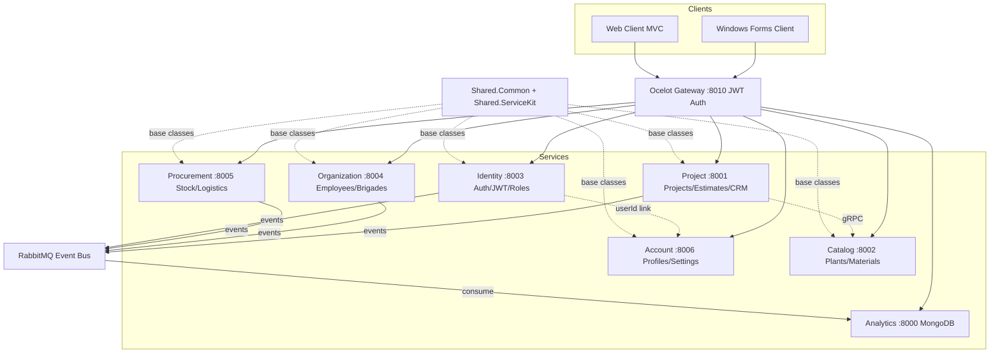

# Информационная система для студии ландшафтного дизайна

## Техническая спецификация и планирование

**Версия:** 2.0  
**Статус:** В разработке  
**Дата:** Октябрь 2026

---

## 1. Обзор продукта

Enterprise-grade информационная система для студии ландшафтного дизайна, построенная на микросервисной архитектуре с центральным API-шлюзом. Система управляет полным жизненным циклом бизнеса: продажи и отношения с клиентами, проектирование и выполнение работ, закупки и логистика, организация сотрудников, расчёт смет.

### Клиенты
- **Web-клиент** — ASP.NET Core MVC с Razor views
- **Windows Forms клиент** — отдельное desktop-приложение

### Архитектура
- 7 бэкенд-микросервисов за Ocelot API Gateway
- Event-driven messaging через RabbitMQ (MassTransit)
- gRPC для межсервисных вызовов
- Фреймворк расширяемости (Shared.Common + Shared.ServiceKit)

---

## 2. Ролевая модель и безопасность

### Роли системы
| Роль | Описание | Права |
|------|----------|-------|
| **Administrator** | Полный доступ | CRUD на все сущности, управление пользователями, экспорт аналитики |
| **User** | Ограниченный доступ | CRUD на назначенные проекты, просмотр каталога, создание заявок |

### Разделение должности и роли
Должность сотрудника (прораб, дизайнер, бригадир) и роль учётной записи в системе (Administrator, User) — **разные сущности**. Прораб может быть обычным пользователем приложения, а администратор системы не обязательно является руководителем организации.

### Разделение Identity и Account
- **Identity Service** — аутентификация, JWT, роли, разрешения, login/logout. Не хранит профильные данные.
- **Account Service** — профиль пользователя, контакты, настройки, предпочтения. Отдельный сервис, связан с Identity через UserId.

---

## 3. Микросервисы

| # | Сервис | Назначение | База данных | Порт | Статус |
|---|--------|-----------|-------------|------|--------|
| 1 | Identity | Аутентификация, JWT, роли, разрешения | PostgreSQL/SQLite | 8003 | NEW |
| 2 | Account | Профили, контакты, настройки, предпочтения | PostgreSQL/SQLite | 8006 | NEW |
| 3 | Project | Участки, проекты, этапы, задачи, сметы, CRM | PostgreSQL/SQLite | 8001 | Rewrite (Account.*) |
| 4 | Catalog | Растения, материалы, виды работ, единицы | PostgreSQL/SQLite | 8002 | Rewrite (Customer.*) |
| 5 | Organization | Сотрудники, должности, бригады, назначения | PostgreSQL/SQLite | 8004 | NEW |
| 6 | Procurement | Поставщики, закупки, запасы, логистика | PostgreSQL/SQLite | 8005 | NEW |
| 7 | Analytics | Аналитика, экспорт, аудит, события | MongoDB | 8000 | Rewrite (Transaction.API) |

### API Gateway
- Ocelot на порту 8010
- JWT-аутентификация на уровне шлюза
- Маршрутизация ко всем 7 сервисам
- Кеширование для read-only эндпоинтов

---

## 4. Доменные области

### 4.1. Сотрудники и организация (Organization Service)
- **Сотрудники** (Employee): ФИО, контакты, должность
- **Должности** (Position): название, описание — организационная, не системная роль
- **Бригады** (Brigade): название, бригадир, состав
- **Члены бригады** (BrigadeMember): сотрудник + бригада + роль в бригаде
- **Назначения на проект** (ProjectAssignment): сотрудник/бригада → проект, ответственный

### 4.2. Продажи и CRM (Project Service)
- **Заявки** (Lead): источник, контакт, статус, дата
- **Клиенты** (Client): ФИО, контакты, адрес, история
- **Переговоры** (Negotiation): клиент, дата, результат, заметки
- **Предложения** (Proposal): клиент, смета, срок, статус
- **Договоры** (Contract): клиент, проект, сумма, сроки, статус
- **Заказы на работы** (WorkOrder): проект, этапы, ответственный, статус

### 4.3. Проектирование и выполнение работ (Project Service)
- **Участки** (LandPlot): адрес, площадь, описание, координаты
- **Проекты** (Project): участок, клиент, статус, сроки, бюджет
- **Этапы** (ProjectStage): проект, название, порядок, сроки, статус
- **Задачи** (ProjectTask): этап, название, исполнитель, срок, результат
- **Сметы** (Estimate): проект, позиции, итоговая стоимость, статус
- **Позиции сметы** (EstimateLineItem): тип (работа/материал), количество, цена, сумма

### 4.4. Закупки, запасы и логистика (Procurement Service)
- **Поставщики** (Supplier): название, контакты, условия
- **Заказы на закупку** (PurchaseOrder): поставщик, дата, позиции, сумма, статус
- **Позиции заказа** (PurchaseOrderItem): материал, количество, цена
- **Поступления** (MaterialReceipt): заказ, материал, количество, дата
- **Остатки** (StockBalance): материал, количество, склад
- **Движение запасов** (StockMovement): тип (приход/расход), материал, количество, дата
- **Доставки** (Delivery): участок, дата, ответственный, статус
- **Позиции доставки** (DeliveryItem): материал, количество

### 4.5. Сметы и расчёты (Project Service)
- Позиции сметы: работы и материалы
- Количество, единицы измерения, расценки
- Стоимость работ и материалов
- Затраты проекта и расчёт итоговой цены
- Фактические затраты и отклонение от оценки (variance tracking)

### 4.6. Каталог (Catalog Service)
- **Растения** (Plant): название, латинское название, описание, цена
- **Материалы** (Material): название, единица, цена, описание
- **Виды работ** (WorkType): название, единица, базовая цена
- **Единицы измерения** (MeasurementUnit): название, сокращение

---

## 5. Аналитика, экспорт и импорт (Analytics Service)

### Функциональность
- Агрегационные запросы через MongoDB aggregation pipelines
- Экспорт табличных результатов в текстовый файл (pipe-delimited и CSV)
- Импорт из текстового файла
- Сохранение и восстановление состояния приложения (JSON serialization)
- Аудит-лог всех событий через event bus

### Event Bus Consumers
Analytics Service потребляет все интеграционные события:
- ProjectStageCompletedEvent
- EmployeeAssignedEvent
- PurchaseOrderCreatedEvent
- EstimateApprovedEvent
- MaterialReceivedEvent
- UserRegisteredEvent
- ProfileUpdatedEvent

---

## 6. Технологический стек

| Компонент | Технология |
|-----------|-----------|
| Framework | .NET 8.0 |
| Web API | ASP.NET Core Web API |
| Web Client | ASP.NET Core MVC (Razor) |
| Desktop Client | Windows Forms |
| API Gateway | Ocelot |
| ORM | Entity Framework Core 8 |
| Реляционная БД | PostgreSQL (primary), SQL Server, SQLite (fallback) |
| NoSQL БД | MongoDB |
| Message Broker | RabbitMQ + MassTransit |
| gRPC | gRPC for inter-service calls |
| CQRS | MediatR |
| Validation | FluentValidation |
| Mapping | AutoMapper |
| Logging | Serilog (Console + Elasticsearch) |
| Auth | JWT Bearer tokens |
| Resilience | Polly retry policies |
| Containerization | Docker + docker-compose |

---

## 7. Паттерны проектирования

| Паттерн | Применение |
|---------|-----------|
| **CQRS** | Разделение команд и запросов через MediatR |
| **Repository** | Generic IRepositoryBase<T> + RepositoryBase<T> |
| **Mediator** | MediatR для развязки handlers и controllers |
| **Factory** | DatabaseProviderFactory — выбор провайдера БД |
| **Strategy** | IDatabaseProviderStrategy — PostgreSQL/SQLite/SqlServer |
| **Observer** | Event bus (MassTransit/RabbitMQ) — pub/sub |
| **Specification** | ISpecification<T> — композиция бизнес-правил |
| **Decorator** | MediatR pipeline behaviours (validation, logging) |

---

## 8. Фреймворк расширяемости

### Shared.Common
Дедуплицированные базовые классы:
- `EntityBase` — абстрактный базовый класс сущности
- `IDatabaseProviderStrategy` + реализации — стратегия выбора БД
- `DatabaseProviderFactory` — фабрика с автоматическим fallback на SQLite
- `IRepositoryBase<T>` + `RepositoryBase<T>` — generic repository (исправлен bug с hardcoded context type)
- `ITextFileSerializer` + `PipeDelimitedSerializer` + `CsvTextSerializer` — экспорт/импорт
- `JsonStateSerializer` — сохранение/восстановление состояния
- `ISpecification<T>` + `BaseSpecification<T>` — specification pattern
- `NotFoundException`, `ValidationException`, `ForbiddenException` — иерархия исключений

### Shared.ServiceKit
Каркас для создания новых микросервисов:
- `IServiceDefinition` — контракт микросервиса (имя, версия, регистрация)
- `IMicroserviceTemplate` — marker interface с метаданными (порт, health path)
- `MicroserviceBootstrapBase` — абстрактный базовый класс для Program.cs
- `ServiceRegistrationBase` — базовый класс для Application-регистрации
- `ServiceDiscoveryHelper` — регистрация health checks

**Создание нового микросервиса:**
1. Создать 4-слойный проект (Domain → Application → Infrastructure → API)
2. В Program.cs унаследовать от `MicroserviceBootstrapBase`
3. Реализовать `IServiceDefinition` (или `IMicroserviceTemplate`)
4. В ApplicationServiceRegistration унаследовать от `ServiceRegistrationBase`
5. В InfrastructureServiceRegistration использовать `DatabaseProviderFactory`

---

## 9. Обработка исключений

### Иерархия исключений
```
ApplicationException
├── NotFoundException      → HTTP 404
├── ValidationException    → HTTP 400 (with Errors dictionary)
└── ForbiddenException     → HTTP 403
```

### Global Exception Handling Middleware
Каждый сервис имеет middleware для перехвата исключений и возврата стандартизированных HTTP-ответов.

### MediatR Pipeline Behaviours
- `ValidationBehaviour<TRequest, TResponse>` — валидация до обработчика
- `UnhandledExceptionBehaviour<TRequest, TResponse>` — логирование неперехваченных исключений

---

## 10. База данных — стратегия провайдера

### DatabaseProviderFactory (Factory + Strategy)
1. Читает `DatabaseSettings:Provider` из конфигурации (Postgres, SqlServer, или Sqlite)
2. Проверяет `CanConnect(connectionString)` для выбранного провайдера
3. Если PostgreSQL/SqlServer недоступен — **автоматический fallback на SQLite**
4. SQLite файл всегда указан в `appsettings.json` как fallback

### Конфигурация (appsettings.json)
```json
{
  "DatabaseSettings": {
    "Provider": "Postgres",
    "ConnectionString": "Host=localhost;Database=identitydb;...",
    "SqliteFallbackPath": "Data Source=identity_fallback.db"
  }
}
```

---

## 11. Безопасность

### JWT-аутентификация
- Identity Service генерирует JWT с claims: `sub` (UserId), `role`, `permissions`
- Срок действия токена: configurable (default 60 минут)
- Шифрование: HS256 с симметричным ключом

### Авторизация
- Gateway: валидация JWT на каждом запросе
- Service-level: `[Authorize(Roles = "Administrator")]` для admin-only эндпоинтов
- Permission-based: custom `[HasPermission("...")]` attribute для fine-grained контроля

### Безопасность данных
- Пароли хешируются (BCrypt/PBKDF2), никогда не логируются
- JWT-токены не логируются
- PII (личные данные) не попадают в логи

---

## 12. Docker-инфраструктура

### Контейнеры
| Контейнер | Образ | Порт |
|-----------|-------|------|
| PostgreSQL | postgres:16-alpine | 5432 |
| MongoDB | mongo:7 | 27017 |
| RabbitMQ | rabbitmq:3-management | 5672, 15672 |
| Elasticsearch | elasticsearch:8 | 9200 |
| Kibana | kibana:8 | 5601 |
| pgAdmin | dpage/pgadmin4 | 5050 |
| Mongo Express | mongo-express | 8081 |
| API Gateway | — | 8010 |
| Identity.API | — | 8003 |
| Account.API | — | 8006 |
| Project.API | — | 8001 |
| Catalog.API | — | 8002 |
| Organization.API | — | 8004 |
| Procurement.API | — | 8005 |
| Analytics.API | — | 8000 |
| WebStatus | — | 8007 |
| LandscapeStudio.Web | — | 8008 |

---

## 13. Диаграмма архитектуры



---

## 14. Поток данных

1. Пользователь входит через Identity Service → получает JWT с ролями/разрешениями
2. Клиент получает профиль из Account Service по UserId из JWT
3. Клиент включает JWT во все последующие запросы через Gateway
4. Gateway маршрутизирует к микросервису, валидирует JWT
5. Сервис проверяет права через `[Authorize]` и custom permission attributes
6. Межсервисные вызовы через gRPC (Project Service проверяет элементы Catalog)
7. Доменные события публикуются в RabbitMQ → Analytics Service потребляет и хранит в MongoDB
8. Analytics Service предоставляет агрегационные запросы + экспорт в текстовый файл

---

## 15. Известные баги (исправляются при трансформации)

| # | Файл | Ошибка | Исправление |
|---|------|--------|-------------|
| 1 | Account.Application/Queries/AccountQueryHandler | Logic bug: CustomerId vs AccountId | Переписано как Project queries |
| 2 | Account.Application handlers/behaviours | Dead NotImplementedException overloads | Удалено |
| 3 | Customer.Application/Queries | No null check on handler result | Добавлены null checks |
| 4 | Customer.API.csproj | Unnecessary Microsoft.Data.SqlClient | Удалено |
| 5 | Transaction.GRPC | Placeholder scaffold | Удалено полностью |
| 6 | RepositoryBase | Hardcoded concrete context type | Использован DbContext base type |

---

## 16. Производительность

- `AsNoTracking()` на всех read-запросах
- MediatR pipeline validation до обработчика — без лишних DB round-trips
- MongoDB aggregation pipelines для аналитики (server-side)
- Пагинация на всех list-эндпоинтах
- Ocelot кеширование для read-only маршрутов
- Polly retry для БД-подключений при старте

---

## 17. Логирование

- Serilog: Console sink + Elasticsearch sink
- MediatR exceptions логируются через `UnhandledExceptionBehaviour`
- PII не логируется: JWT-токены и пароли никогда не попадают в логи
- Структурированный формат: JSON в Elasticsearch, человекочитаемый в Console
